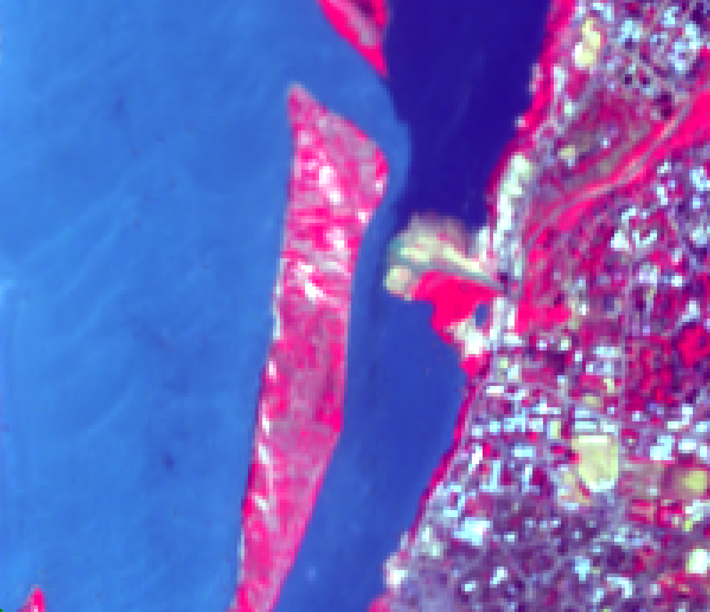

# River Niger Water-Body Segmentation Using Object-Based Image Analysis (OBIA)

## Project Overview

This project explores the application of **Object-Based Image Analysis (OBIA)** and satellite remote sensing techniques for identifying and extracting water bodies along the River Niger in Onitsha, Anambra State, Nigeria.

Using Sentinel-2 Level-2A satellite imagery acquired on **5 February 2026**, the project combines the Normalized Difference Water Index (NDWI), Otsu thresholding and Felzenszwalb image segmentation to classify image objects into water and non-water categories.

Unlike traditional pixel-based classification, which evaluates individual pixels independently, OBIA groups neighbouring pixels into meaningful image segments and classifies these segments based on their spectral characteristics.

The project was implemented using Python in Google Colab, with QGIS used for geospatial visualisation and cartographic presentation.

## Study Area

The study focuses on a section of the River Niger around Onitsha, Anambra State, southeastern Nigeria.

The area was selected to demonstrate how satellite imagery and object-based classification techniques can be applied to water-body extraction within a real geographic environment.

## Objectives

- Extract water-body features from Sentinel-2 satellite imagery.
- Calculate NDWI to distinguish potential water pixels from surrounding land cover.
- Apply Otsu thresholding to determine an appropriate water-classification threshold.
- Segment the satellite imagery into meaningful objects using the Felzenszwalb segmentation algorithm.
- Classify segmented objects based on their water-pixel composition.
- Export the classified water objects into geospatial formats for visualisation and further analysis.

## Data Sources

**Satellite Data:** Sentinel-2 Level-2A imagery.

**Acquisition Date:** 5 February 2026.

**Spectral Bands Used:**

| Band | Description | Resolution |
|---|---|---|
| B03 | Green | 10 m |
| B04 | Red | 10 m |
| B08 | Near Infrared (NIR) | 10 m |

The Green and Near Infrared bands were used for NDWI calculation, while the three bands were combined to provide spectral information for image segmentation.

## Methodology

The workflow consisted of the following stages:

### 1. Satellite Image Acquisition

Sentinel-2 Level-2A imagery covering the selected section of the River Niger was obtained from the Copernicus Browser.

The required spectral bands were downloaded and prepared for processing.

### 2. Normalized Difference Water Index (NDWI)

NDWI was calculated using the Green and Near Infrared bands to highlight potential water features.

The formula used was:

\[
NDWI = \frac{Green-NIR}{Green+NIR}
\]

Higher NDWI values generally indicate water-related surfaces, although other land-cover features can sometimes produce similar values.

### 3. Otsu Thresholding

Otsu's thresholding method was applied to the NDWI image to determine an automatic threshold for separating potential water pixels from non-water pixels.

Invalid pixels were excluded from the threshold calculation and subsequent classification.

The resulting threshold was approximately **-0.0154**.

Pixels above this threshold were initially identified as potential water pixels.

### 4. Image Segmentation Using Felzenszwalb

The satellite imagery was prepared as a three-channel input using the normalised Green, Near Infrared and NDWI layers.

The Felzenszwalb graph-based segmentation algorithm was then applied using the following parameters:

| Parameter | Value |
|---|---:|
| Scale | 100 |
| Sigma | 0.8 |
| Minimum Segment Size | 30 |

The segmentation process generated **168 image segments**.

### 5. Object-Based Classification

Following segmentation, each image object was evaluated using the proportion of its valid pixels classified as potential water.

An object was classified as water where at least 50% of its valid pixels met the NDWI water threshold.

This object-level classification resulted in **32 classified water-object features**.

### 6. Geospatial Export and Visualisation

The classified water objects were exported as GeoJSON features for use in GIS software.

The final water classification raster was also exported, with the following pixel values:

- `0` – Non-water
- `1` – Water
- `255` – Invalid or NoData pixels

The GeoJSON output was subsequently loaded into QGIS and overlaid on the Sentinel-2 false-colour composite for visual inspection and cartographic presentation.

## Technologies and Tools

- **Python** – Image processing and geospatial analysis.
- **Google Colab** – Cloud-based development and execution of the analysis notebook.
- **NumPy** – Numerical operations and raster array processing.
- **Rasterio** – Raster data reading, processing and export.
- **scikit-image** – NDWI thresholding and Felzenszwalb image segmentation.
- **Shapely** – Geometric processing and polygon consolidation.
- **GeoPandas** – Geospatial vector data handling.
- **Matplotlib** – Image visualisation.
- **QGIS** – Geospatial visualisation, layer styling and map production.
- **Sentinel-2** – Multispectral satellite imagery.

## Project Outputs

The analysis produced the following outputs:

| Output | Description |
|---|---|
| `river_niger_onitsha_water_mask.tif` | Classified water and non-water raster |
| `river_niger_onitsha_OBIA_objects_corrected.geojson` | Final GeoJSON containing 32 classified water-object features |
| `River_Niger_False_Colour_Composite.vrt` | Virtual raster combining the selected Sentinel-2 bands |
| PNG visualisation | Rendered output for visual inspection |
| Jupyter Notebook (`.ipynb`) | Python code and complete processing workflow |

## Key Results

| Analysis | Result |
|---|---:|
| Initial image segments | 168 |
| Classified water objects | 32 |
| Final water pixels | 19,437 |
| NDWI threshold | -0.0154 |
| Minimum segment size | 30 pixels |
| Felzenszwalb scale | 100 |
| Felzenszwalb sigma | 0.8 |

The results demonstrate how spectral indices and object-based segmentation can be combined to extract potential water features from multispectral satellite imagery.

## Limitations and Considerations

This project is an exploratory implementation of OBIA for water-body extraction.

The classification relies primarily on NDWI-derived spectral information and an object-level water-pixel proportion threshold. Consequently, some non-water surfaces with similar spectral responses may be classified as water, while certain water features may be missed.

The resulting 32 features represent classified image objects, not necessarily 32 independent water bodies.

The extracted boundaries have not been independently validated against field-surveyed water boundaries or an authoritative reference dataset. Therefore, the outputs should be interpreted as preliminary water-body extraction results rather than a fully validated hydrological dataset.

## Potential Applications

The workflow demonstrates techniques that can support:

- Surface water mapping.
- River and water-body monitoring.
- Flood extent mapping.
- Land-cover analysis.
- Environmental monitoring.
- Geospatial feature extraction.
- Remote sensing and GIS research.

## Future Improvements

Further development could include:

- Incorporating additional Sentinel-2 spectral bands.
- Comparing NDWI with Modified NDWI (MNDWI) and other water indices.
- Testing alternative segmentation algorithms and parameter combinations.
- Validating extracted water boundaries against reference data.
- Automating the workflow for larger geographic areas.
- Extending the analysis to multi-temporal imagery for monitoring changes in river extent.

## Repository Contents

The repository contains the Jupyter Notebook documenting the analysis workflow and the associated project outputs.

## Author

**Akachukwu Okoro**

Geospatial Technology | Remote Sensing | GIS | Python | Object-Based Image Analysis (OBIA)

---

*This project was developed as a practical demonstration of applying remote sensing, Python-based image processing and object-based image analysis to water-body extraction using Sentinel-2 satellite imagery.*
